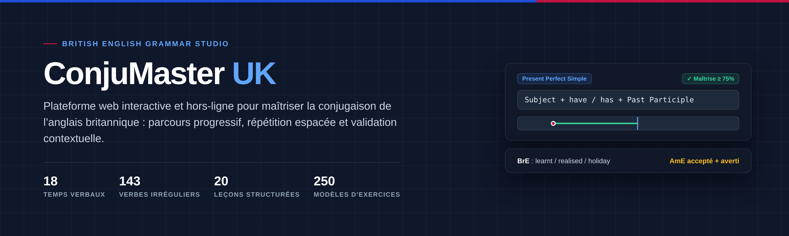
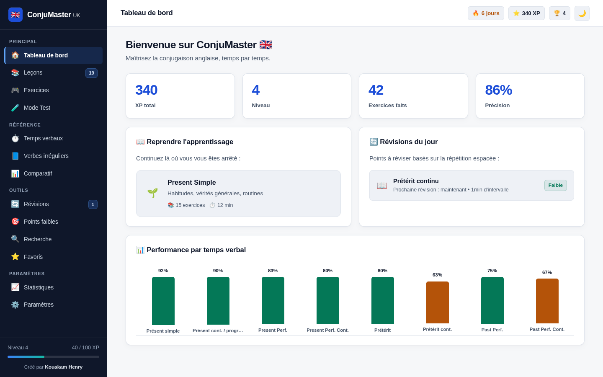
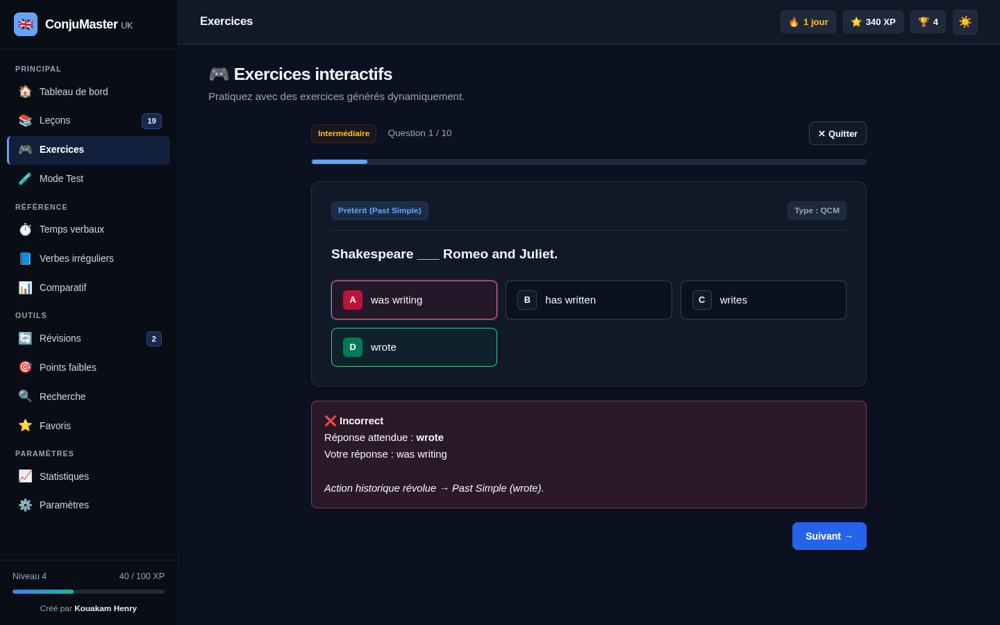
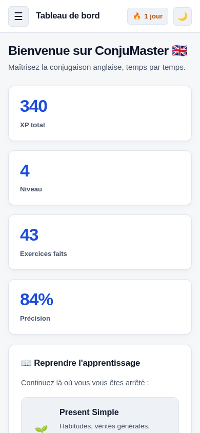
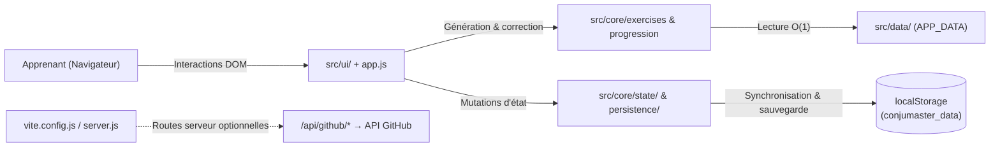

<p align="center">
  
</p>

<h1 align="center">ConjuMaster UK</h1>

<p align="center">
  <strong>Application web interactive et hors-ligne pour maîtriser la conjugaison de l’anglais britannique.</strong>
</p>

<p align="center">
  <a href="https://github.com/kmsohenry-hub/conjumastery/actions/workflows/ci.yml">
    
  </a>
  
  
  
  
  <a href="LICENSE">
    
  </a>
</p>

---

**ConjuMaster UK** enseigne la grammaire et la conjugaison anglaises en plaçant l’**anglais britannique (_British English_)** au centre du parcours, sans transformer chaque exercice en QCM rigide. Les données pédagogiques, le moteur de correction et la progression restent entièrement locaux dans le navigateur (PWA installable, stockage `localStorage`, fonctionnement hors-ligne), tandis qu’une couche Node optionnelle expose des routes `/api/github/*` sécurisées côté serveur lorsque l’application est hébergée.

## Table des matières

- [Aperçu de l’interface](#-aperçu-de-linterface)
- [Approche pédagogique & moteur d’exercices](#-approche-pédagogique--moteur-dexercices)
- [Architecture & flux de données](#-architecture--flux-de-données)
- [Démarrage rapide & scripts](#-démarrage-rapide--scripts)
- [Intégration GitHub côté serveur](#-intégration-github-côté-serveur)
- [Qualité, accessibilité & budgets de performance](#-qualité-accessibilité--budgets-de-performance)
- [Sécurité & modèles de données](#-sécurité--modèles-de-données)
- [Contribuer & limites connues](#-contribuer--limites-connues)
- [Auteur & licence](#-auteur--licence)

---

## Aperçu de l’interface

<table>
  <tr>
    <td width="50%" valign="top">
      <p align="center">
        
      </p>
      <p align="center"><sub><strong>Tableau de bord (clair)</strong> — Suivi XP, série quotidienne, file de révision espacée et performance par temps verbal.</sub></p>
    </td>
    <td width="50%" valign="top">
      <p align="center">
        
      </p>
      <p align="center"><sub><strong>Mode Exercices (sombre)</strong> — Interface contrastée WCAG AA, feedback immédiat et explications grammaticales contextualisées.</sub></p>
    </td>
  </tr>
  <tr>
    <td colspan="2" align="center">
      
      <p><sub><strong>Affichage mobile (390 × 844)</strong> — Navigation latérale repliable avec verrouillage du défilement arrière-plan et cibles tactiles ≥ 44 px.</sub></p>
    </td>
  </tr>
</table>

---

## Approche pédagogique & moteur d’exercices

### Couverture grammaticale

| Domaine                         | Volume vérifié            | Détails                                                                                                                                                    |
| ------------------------------- | ------------------------- | ---------------------------------------------------------------------------------------------------------------------------------------------------------- |
| **Temps & structures verbales** | **18 temps + 2 thèmes**   | Présent (2), Perfect (4), Passé (2), Futur (5), Conditionnels (5 : _0, 1st, 2nd, 3rd, Mixed_), plus 2 leçons transverses (Voix passive, Discours indirect) |
| **Parcours séquentiel**         | **4 modules / 20 leçons** | _Les bases_ (5), _Intermédiaire_ (5), _Avancé_ (5), _Expert_ (5) — seuil de maîtrise à **75 %** (`UNLOCK_THRESHOLD`)                                       |
| **Modèles d’exercices**         | **250 modèles**           | `qcm` (89), `fill` (86), `correction` (43), `translation` (32), complétés par un générateur dynamique                                                      |
| **Dictionnaires de référence**  | **221 entrées**           | 143 verbes irréguliers, 11 modaux, 26 _phrasal verbs_, 41 verbes d’état (_stative verbs_)                                                                  |

### Cinq types d’exercices + évaluation

- **QCM**, **phrases à compléter**, **transformations** (affirmatif ↔ négatif / interrogatif), **correction d’erreurs**, **traductions FR → EN** et **mode mixte**.
- **Mode Test** : épreuve chronométrée de **20 questions** filtrables par temps et par niveau, avec bilan détaillé.
- **Répétition espacée** (`src/core/state/store.js`) : file de révision adaptative dérivée de l’algorithme SM-2 (intervalle plafonné à 1 an, facteur de facilité borné entre `1.3` et `3.0` à partir de `2.5`, priorisation des erreurs récentes).

### Priorité à l’anglais britannique & validation tolérante

Le module `src/core/exercises/validation.js` distingue la correction grammaticale de la variante orthographique ou lexicale :

1. **Normalisation syntaxique** (`answerMatches`) : gère ponctuation, apostrophes typographiques, expansion des contractions (`won't` ↔ `will not`, `'s` ↔ `is`/`has`, `'d` ↔ `would`/`had`), inversion des propositions conditionnelles (`If X, Y` ↔ `Y if X`), omission facultative de `that` au discours indirect et variantes séparées par `/`.
2. **Détection explicite de l’anglais américain** (`checkAmericanEnglishUsage`) : les variantes américaines courantes (`learned`, `gotten`, `traveled`, `realize`, `color`, `movie`, `vacation`, `apartment`, `elevator`, `soccer`…) sont **acceptées**, mais accompagnées d’un avertissement explicite rappelant la forme britannique attendue (`learnt`, `got`, `travelled`, `realise`, `colour`, `film`, `holiday`, `flat`, `lift`, `football`).

---

## Architecture & flux de données

### Organisation du dépôt

```text
conjumastery/
├── index.html                  # Point d'entrée HTML, CSP stricte, conteneurs de vues
├── style.css                   # Système visuel "Oxford Studio" (clair / sombre / responsive)
├── app.js                      # Bootstrap, événements délégués, export global contrôlé
├── sw.js                       # Service Worker PWA avec cache hashé et pré-cache généré au build
├── public/
│   ├── manifest.webmanifest    # Métadonnées d'installation PWA copiées à la racine de dist/
│   └── icons/                  # Icônes PWA (192×192, 512×512)
├── server.js                   # Serveur HTTP de production (dist/ + middleware /api/github)
├── server/
│   ├── githubMiddleware.js     # Routeur /api/github/* avec restriction loopback stricte
│   └── githubService.js        # Client GitHub REST v3 (timeout 15 s, sans exposition de GITHUB_TOKEN)
├── scripts/
│   └── performance-budget.mjs  # Contrôle automatisé des poids HTML / CSS / JS dans dist/
├── src/
│   ├── pwa.js                  # Enregistrement SW, bannière hors-ligne, notification de mise à jour
│   ├── data/                   # 10 modules de contenu + façade APP_DATA avec index O(1)
│   ├── core/
│   │   ├── exercises/          # ExerciseEngine, conjugaison, générateur, mélange, validation
│   │   ├── persistence/        # Chargement, migration et import/export localStorage
│   │   ├── state/              # Store pur, fusion multi-onglets, sélecteurs, façade State
│   │   ├── progression.js      # Déblocage séquentiel des 20 leçons (seuil 75 %)
│   │   └── security.js         # escapeHtml(), sanitizeInput()
│   └── ui/
│       ├── pages/              # Tableau de bord, leçons, exercices, test, temps, verbes, etc.
│       ├── utils/              # Toasts, confettis, notifications navigateur
│       └── navigation.js       # Routage interne, thème clair/sombre, modales, tiroir mobile
├── __tests__/                  # 47 fichiers Vitest (unitaires, intégration, régression, sécurité)
└── e2e/                        # 3 specs Playwright (parcours app, accessibilité axe-core, responsive)
```

### Flux applicatif



---

## Démarrage rapide & scripts

### Prérequis

- **Node.js `>= 24 < 25`** (voir `.nvmrc` et `package.json`)
- **npm** (`npm ci` recommandé pour respecter `package-lock.json`)

### Installation locale

```bash
git clone https://github.com/kmsohenry-hub/conjumastery.git
cd conjumastery
npm ci
npm run dev
```

L’application est alors servie par Vite sur `http://localhost:3000`.

### Scripts disponibles

| Commande                | Rôle                                                                              |
| ----------------------- | --------------------------------------------------------------------------------- |
| `npm run dev`           | Démarre le serveur de développement Vite                                          |
| `npm run build`         | Compile les assets minifiés (`terser`), découpe les chunks et génère `dist/sw.js` |
| `npm run preview`       | Prévisualise le dossier `dist/` via Vite                                          |
| `node server.js`        | Démarre le serveur Node de production (`PORT=3000` par défaut)                    |
| `npm test`              | Exécute la suite unitaire et d’intégration **Vitest**                             |
| `npm run test:coverage` | Vérifie la couverture (`@vitest/coverage-v8`) avec seuils bloquants               |
| `npm run test:e2e`      | Lance les tests **Playwright** (bureau, mobile et audit `axe-core`)               |
| `npm run lint`          | Vérifie les règles **ESLint** (`--max-warnings 0`) sur tout le dépôt              |
| `npm run format:check`  | Vérifie le formatage **Prettier** (`.js`, `.css`, `.json`, `.md`)                 |
| `npm run perf:budget`   | Contrôle les budgets de taille des fichiers générés dans `dist/`                  |

---

## Intégration GitHub côté serveur

Lorsque le serveur Vite (`npm run dev` / `npm run preview`) ou `server.js` est actif, `server/githubMiddleware.js` et `server/githubService.js` exposent une interface serveur vers `api.github.com` sous `/api/github/*` (statut, branches, contenu, commits atomiques via l’API Git Data, Pull Requests et suivi GitHub Actions).

- **Configuration** : renseignez `GITHUB_TOKEN` (et optionnellement `GITHUB_OWNER` / `GITHUB_REPO`) dans les variables d’environnement du serveur Node.
- **Cloisonnement strict** : le jeton n’est lu que via `process.env.GITHUB_TOKEN` côté Node.js, filtré des messages d’erreur (`[REDACTED]`) et jamais transmis au frontend.
- **Restriction loopback complète** : toute requête (lecture ou écriture) sur `/api/github/*` vérifie l’origine _loopback_ (`127.0.0.1` / `::1` sans en-tête `x-forwarded-for`), et les appels sortants vers GitHub disposent d’un timeout de 15 s (HTTP `504` en cas d’expiration).

---

## Qualité, accessibilité & budgets de performance

Le pipeline défini dans `.github/workflows/ci.yml` exécute les contrôles suivants :

1. **Audit des dépendances** : `npm audit --audit-level=moderate` (complété par `.github/dependabot.yml` pour les mises à jour hebdomadaires groupées npm et GitHub Actions).
2. **Qualité de code** : `npm run lint` (`ESLint --max-warnings 0`) + `npm run format:check` (Prettier).
3. **Suite unitaire & intégration (47 fichiers, 796 tests)** : couverture minimale exigée dans `vite.config.js` :
   - **Statements / Functions / Lines** : `≥ 95 %`
   - **Branches** : `≥ 90 %`
4. **Budgets de production (`npm run perf:budget`)** :
   - `index.html` ≤ **35 KiB**
   - Feuille CSS minifiée ≤ **35 KiB**
   - Chaque bundle JavaScript (dont `curriculum-data`) ≤ **180 KiB**
5. **Tests E2E & accessibilité (`e2e/*.spec.js`)** : 27 tests Playwright vérifiant les parcours critiques (exercices, mode test chronométré, révision Voix Passive / Discours Indirect, recherche, sauvegarde/import, réinitialisation accessible), la non-régression responsive mobile/bureau sans débordement horizontal et l’absence de violation WCAG 2.0 A / AA **critical** ou **serious** via `@axe-core/playwright` sur l’ensemble des 13 vues, en mode sombre, avec modale active, en cours d’exercice / de test et sur les vues peuplées.

---

## Sécurité & modèles de données

### Mesures appliquées

- **Content Security Policy (`index.html` & `server.js`)** :
  ```text
  default-src 'self'; script-src 'self'; style-src 'self'; style-src-elem 'self'; style-src-attr 'unsafe-inline'; img-src 'self' data:; connect-src 'self'; object-src 'none'; base-uri 'self'; form-action 'self'
  ```
  En production (`server.js`), la réponse HTML renforce en outre l’en-tête HTTP `Content-Security-Policy` avec `frame-ancestors 'none'` en complément de `X-Frame-Options: DENY`, `X-Content-Type-Options: nosniff` et de délais HTTP bornés (`requestTimeout`, `headersTimeout`, `keepAliveTimeout`).
- **Protection XSS & imports** : tout contenu dynamique inséré dans le DOM passe par `escapeHtml()`, les saisies utilisateur sont rognées et bornées à 500 caractères par `sanitizeInput()`, et les sauvegardes importées (plafonnées à 2 Mo) sont validées, nettoyées, dédupliquées et migrées (`migrateState` / `sanitizeState`) avant écriture dans le store.
- **Stockage borné** : `errorLog` et `activityLog` sont plafonnés à **100 entrées** chacun (`MAX_ERROR_LOG_ENTRIES`, `MAX_ACTIVITY_LOG_ENTRIES`), et l’état se synchronise entre onglets via `mergeStates()`.

### Schéma `APP_DATA` (`src/data/index.js`)

```javascript
{
  tenses: [...],             // 18 temps (id, name, nameFR, level, structure, timeline, examples...)
  modules: [...],            // 4 modules ordonnés totalisant 20 leçons
  exerciseTemplates: {},     // Dictionnaire indexé par tenseId -> { qcm, fill, correction, translation }
  irregularVerbs: [...],     // 143 verbes (base, past, pp, meaning...)
  modals: [...],             // 11 modaux et règles d'usage
  phrasalVerbs: [...],       // 26 verbes à particule
  stativeVerbs: [...],       // 41 verbes d'état
  passiveInfo: {},           // Règles et tableaux de voix passive
  reportedSpeech: {},        // Concordance des temps et marqueurs temporels
  tensesById: {},            // Index O(1) par identifiant de temps
  specialTopicsById: {},     // Index O(1) pour passive_voice et reported_speech
  verbsByBase: {},           // Index O(1) par base verbale
}
```

### Schéma `State` (`localStorage['conjumaster_data']`)

```javascript
{
  xp: Number,
  level: Number,               // Math.floor(xp / 100) + 1
  totalExercises: Number,
  correctAnswers: Number,
  incorrectAnswers: Number,
  bestStreak: Number,
  currentStreak: Number,
  daysStreak: Number,
  lastActiveDate: String | null,
  completedLessons: Array,     // IDs des leçons validées
  tenseStats: Object,          // { [tenseId]: { correct, total } }
  errorLog: Array,             // Max 100 entrées { tenseId, date }
  activityLog: Array,          // Max 100 entrées { date, xp }
  favorites: Array,            // IDs de temps (ex. 'present_simple') et verbes ('verb_<base>')
  spacedRepetition: Object,    // { [tenseId]: { interval, nextReview, ease, errors } }
  settings: { theme: 'light' | 'dark' },
}
```

---

## Contribuer & limites connues

### Limites connues

- **Stockage local** : sans synchronisation cloud utilisateur, les progrès résident dans le navigateur courant (export/import JSON disponible dans _Paramètres_).
- **Synthèse audio / API externes** : l’application ne dépend d’aucune API linguistique distante ; les exercices reposent sur le corpus local et le moteur de conjugaison déterministe.

### Flux de contribution

1. Créez une branche depuis `main` (`git checkout -b fix/ma-correction`).
2. Installez les dépendances avec `npm ci`.
3. Ajoutez des tests pour toute correction grammaticale ou fonctionnelle dans `__tests__/` (et `e2e/` si l’UI change).
4. Validez localement avant d’ouvrir une Pull Request :
   ```bash
   npm run lint && npm run format:check && npm run test:coverage && npm run build && npm run perf:budget
   ```

---

## Auteur & licence

- **Auteur** : **Kouakam Henry**
- **Dépôt** : [github.com/kmsohenry-hub/conjumastery](https://github.com/kmsohenry-hub/conjumastery)
- **Licence** : distribué sous licence **MIT** — voir [LICENSE](LICENSE).
